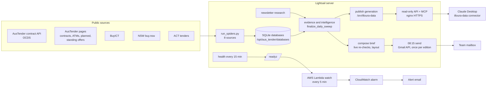

# Architecture

How the Illoura IT Revenue Intelligence system fits together, as of 13 November 2026.
Module-by-module detail is in [reference/](reference/README.md); day-to-day operation is in
[cloud_operations.md](cloud_operations.md) and [runbook.md](runbook.md).

## What it does

Illoura is a Supply Nation certified IT labour-hire business. This system collects public
Australian government procurement data (federal AusTender, BuyICT, NSW and ACT), keeps it in
SQLite databases, turns it into intelligence (who buys what, from whom, when), and gives the
team three ways to use it:

1. **A daily brief email** at 08:15 Sydney: open BuyICT ICT labour-hire requests closing
   soonest, each re-checked live, sent once to the internal team mailbox.
2. **A read-only data API** that Claude Desktop uses (the `illoura-data` connector) to answer
   questions over the data.
3. **Local tools** on the team PC: the BuyICT/BDM monitor, Google Sheets views, and the
   (AI-disabled) local assistant.

Nothing contacts buyers or partners automatically. The only automatic email is the internal
08:15 brief.

## Where things run

| Place | What runs there |
|---|---|
| **AWS Lightsail server** (project `illoura-trial`, Sydney Region, Ubuntu 24.04, 2 vCPU / 8 GB / 160 GB) | Daily collection, evidence, publication, the 08:15 brief, health checks, the read-only API behind nginx (HTTPS, short-lived Let's Encrypt certificate). |
| **AWS (outside the server)** | External watch (Lambda every 5 minutes, CloudWatch alarm, SNS email), Lightsail status-check alarm, daily Lightsail snapshots at 23:00 UTC. |
| **Team PC (Windows)** | Development, the operator CLI, BuyICT/BDM monitor (scheduled task every 15 minutes), Google Sheets sync, Claude Desktop with the `illoura-data` connector, private admin files and their OneDrive backup copy. |
| **GitHub** (private repository) | Code, docs, CI tests on Ubuntu and Windows for every pull request. |

## Data flow

## The morning on the server (Australia/Sydney)

| Time | What happens | Code |
|---|---|---|
| 03:30-04:00 | Ubuntu security updates (kept out of the brief window; needrestart never restarts Illoura jobs) | `deploy/system/` |
| 06:15 | `illoura-daily-brief.timer` starts the brief | `deploy/illoura_daily_brief.py run` |
| 06:15 | Settle any uncertain earlier send that Gmail Sent confirms | `deploy/illoura_cloud_collect.py` |
| 06:15-06:35 | Collect 8 sources + supplemental research, then build evidence | `routine/run_once.py`, `run_spiders.py`, `routine/scripts/` |
| ~06:35 | Back up operations state, restore drill, publish a new immutable data generation with retention | `deploy/illoura_cloud_ops.py` |
| ~06:40 | Compose: shortlist, live re-check of each listing, editorial notes, desktop/mobile layout check, automated review record | `deploy/illoura_daily_brief.py compose`, `routine/scripts/compose_checked_brief.py` |
| 08:15 | Re-check timer and cutoff, then send once per edition; write the receipt | `routine/scripts/send_gmail.py` |
| 09:00 | Health expects today's receipt; otherwise `/readyz` fails and the alarm emails after 30 minutes | `deploy/illoura_cloud_health.py` |
| 12:00 | Cutoff: a brief not ready by now is kept for review, never sent late | |
| every 15 min | Health: freshness, last run, daily brief, coordinator, disk, retention, Gmail authorisation, HTTPS certificate | `deploy/illoura_cloud_health.py` |
| 00:00 and 12:00 (+random) | Certificate renewal check | `illoura-cert-renew.timer` |
| 23:00 UTC | Lightsail automatic snapshot of the whole server (newest 7 kept) | AWS |

## Server layout

| Path | Owner | Contents |
|---|---|---|
| `/opt/aus_tender` | `scraper` | Collector code, Python environment, `databases/`, `logs/` |
| `/opt/illoura-routine` | `scraper` (code root:scraper read-only) | Newsletter routine `run_once.py`, `scripts/`, run folders `reports/daily_sweep_<IST time>/`, state files (`latest_run.json`, `publication.json`, `coordinator_status.json`) |
| `/opt/illoura-ops` | root | Operations code (collect coordinator, publication/retention, health, daily brief) |
| `/srv/illoura-data` | root:illoura-api | Published generations (immutable), `current`/`previous` pointers, retention record |
| `/opt/illoura-api` | root:illoura-api | API application and its environment |
| `/var/lib/illoura-health/status.json` | root:illoura-api | Latest health result, served by `/readyz` |
| `/var/backups/illoura` | root | Operations backups and replaced-code backups |
| `/etc/illoura-*` | root / scraper | Private settings: API key hashes, Gmail token, health sender, routine mail settings |

Run folders are named with India Standard Time (`daily_sweep_YYYYMMDD_HHMMSS`), and the
email's edition date is the India date; at 08:15 Sydney both calendars show the same day.

## Safety rules built into the design

- **Send once.** One send per edition date across all run folders under a server-wide lock; an
  attempt without a receipt blocks further sends and publication until it is reconciled
  against Gmail Sent (`reconcile-send`). Nothing ever re-sends blindly.
- **Fail closed, loudly.** A source gap, failed live checks for most listings, a stale edition,
  changed content after review, a wrong Gmail identity or a missed cutoff stops the send; health
  turns the failure into a `/readyz` 503 and the external alarm emails.
- **Immutable data.** Raw data is never overwritten; published generations are immutable and
  switched atomically; retention never deletes the served or previous generation.
- **Fixed operations.** The operator CLI (`deploy/aws/illoura_aws.py`) runs only fixed
  commands over SSH with a pinned host key; deploys stage files, check SHA-256 on the server,
  run the tests there, then install only changed files and keep the originals.
- **Secrets stay private.** No address, key, token or account id is in the repository; they
  live in private files on the server and in the private workspace on the team PC.
- **Compliant collection.** robots.txt and site terms are respected; no anti-bot evasion, no
  LinkedIn scraping, no local AI model downloads.

## How the team works on it

Codex (OpenAI, in VS Code) and Claude Code share the building: work is split so only one
agent edits a given set of files, the other reviews, and every step is logged in
[workstreams/progress.md](workstreams/progress.md). Sirish approves pushes, deploys, merges,
schedules and any deletion.
