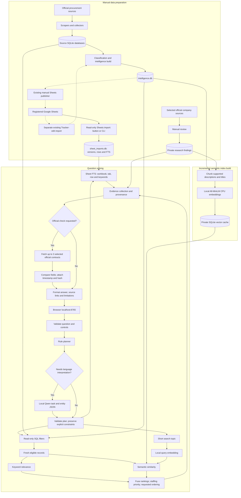

# Illoura assistant architecture

Local pilot 2.3, saved 8 October 2026. This describes implemented behaviour;
candidate matching, general live web research, conversational memory and VPS
access remain unconnected. Model weights have not been trained on Illoura data.

## Complete flow

## Each component

| Component | Responsibility |
|---|---|
| Official sources | Original procurement records from AusTender, BuyICT, ACT, NSW and the dated NIAA list. NIAA import is separate/manual. |
| Scrapers and collectors | Fetch permitted pages/APIs; currently manually run. |
| Source SQLite | Retain collected records and contract versions; authoritative local evidence for procurement queries. |
| Classification/build | Construct role/category signals and derived intelligence. Classification is not verified staffing demand. |
| intelligence.db | Renewal monitoring, opportunities, panels, MMR matches, contacts, rates and actions. |
| Registered Sheets | The ten project workbooks; publishing and human edits can make their contents differ from the current scraper build. |
| Manual publisher | Existing separate workflow that publishes database views to Sheets; the chat never calls it. |
| Tracker-edit import | Existing separate workflow for supported human Tracker edits; generic Sheet imports do not automatically update engine actions. |
| Read-only Sheets importer | Uses only GET requests and spreadsheets.readonly scope; imports into a separate private database. |
| Sheet snapshot store | Retains formatted cells and historical snapshots; switches each active tab only after complete reads; failures retain previous data. |
| Official company sources/review | Selected source findings with review dates, locators and proof limits; not general live web search. |
| Private research register | Reviewed findings rather than full RAP document content. |
| Text chunking | Overlapping chunks with text hashes; unchanged chunks need no new embedding. |
| All-MiniLM | Local CPU model producing normalized 384-dimensional embeddings. |
| Vector cache | SQLite text/vector cache; relevance only, never a replacement for source facts. |
| Browser/validation | Local UI, input bounds, source options, host checks and browser session token. |
| Rule planner | Extract supported tasks, organisations, IDs, roles, dates, values, ABNs and exclusions. |
| Qwen fallback | Helps identify tasks/entities for unfamiliar wording. Returns validated JSON; never generates SQL or factual answers. |
| Validated plan | Preserve rule constraints; reject unsafe extraction and unsupported tasks. |
| SQL filters | Enforce supported exact date, monetary, identity, status and exclusion constraints using read-only parameterized queries. |
| Eligible records | Read current local facts before semantic relevance is considered. Not necessarily verified live. |
| Keyword relevance | BM25 plus preserved exact role matches where applicable. |
| Semantic similarity | Compare the topic embedding with eligible cached vectors; threshold gates weak results and generic short descriptions. |
| Rank fusion | Reciprocal rank fusion; staffing questions preserve explicit staffing/role priority; requested value ordering is handled by code. |
| Sheet FTS | Literal row search with exact workbook/tab/row scope, provenance and sync-time labels. No Sheet-row embeddings. |
| Evidence collection | Combine source facts, reviewed findings and imported cells while preserving their distinct proof scopes. |
| Official verification | Optional comparison of up to three selected contract records against official API fields. Not hiring or relationship verification. |
| Formatter | Deterministic calculations/explanations, evidence links, query dates and missing information. |

## Freshness, consistency and limits

- Source refresh, Sheets sync, manual research review and semantic-index rebuild
  are separate operations. Existing scheduled tasks remain disabled.
- The intelligence build timestamp is checked during retrieval; a changing build
  triggers a retry. This is not one transaction across every source database.
- Sheet queries use one read-only SQLite transaction. Remote Sheet downloads are
  per-tab reads, not an atomic snapshot across Google workbooks.
- Initial semantic coverage: 14,882 renewal records, 203 relevant current
  opportunity titles and 12 reviewed findings, represented by 5,840 unique chunks.
  Full historical contracts, full RAP PDFs and CVs are outside this index.
- Initial Sheets import: 10 workbooks, 26 tabs, 51,637 nonempty rows; no failed reads.
  Read timestamps are UTC. Query dates use Canberra time. Upstream build timestamps
  have no timezone offset and are labelled accordingly.
- Missing/new embeddings, a changed embedding model or unavailable Ollama causes a
  labelled keyword fallback. Results always use current SQL facts.
- Sheet lookups do not normalize arbitrary money/date columns, calculate general
  financial totals or establish who edited a cell. Owner names are not edit history.
- Contract expiry, awards, panels, RAP policies and Sheet notes do not establish
  current staffing demand, candidate readiness or a warm relationship.
- No autonomous outreach, Sheet editing/publishing by the chat, paid model API or
  VPS deployment. Credentials, inputs, databases, caches and operational reports
  remain local and git-ignored.

## Validation and saved guide

83 assistant fixture/unit tests, 90 question regression checks, 195 upstream tests
and browser/HTTP checks passed for this version. The question cases were used
during refinement, so the result is not an independent accuracy estimate. Five
synthetic semantic contrast cases found four positives and rejected five negatives.

See [the PDF user guide](Illoura_AI_Assistant_User_Guide.pdf) and
[assistant setup and examples](../local_assistant/README.md). The optional PDF build
script is `docs/tools/build_ai_guide.py`; install `docs/tools/requirements.txt` to
render it. It creates `output/pdf/` and private previews under `tmp/pdfs/`.
